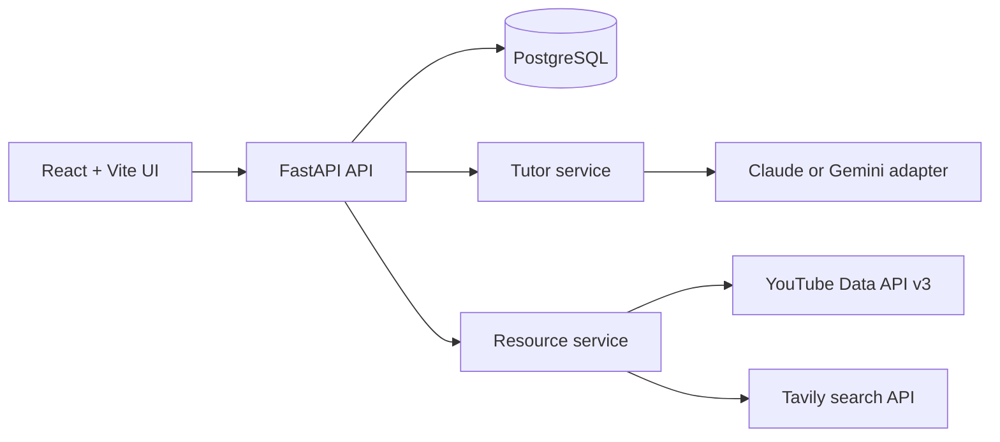

# TutorAI

TutorAI is a local-first AI tutor and mentor. It will learn how a learner
prefers to study, create an adaptive learning plan, find cited resources, and
track progress.

## Current release

This phase provides:

- A FastAPI backend with a health endpoint.
- A local SQLite learner profile with Alembic migrations.
- PostgreSQL-ready configuration, connection pooling, user records, and
  ownership columns for the multi-user migration.
- One-question-at-a-time onboarding and editable profile endpoints.
- A provider-neutral async LLM interface with Anthropic Claude and Google
  Gemini adapters.
- TutorAI system prompt, contextual chat orchestration, answer logging, and
  wrong-answer reports.
- Persisted learning plans with modules, structured lessons, practice tasks,
  quizzes, and lesson progress.
- Official YouTube Data API and configurable web resource search with link
  checks and ranked results.
- Responsive React workspace with onboarding, chat, plan progress, themes,
  and browser read-aloud support.
- Local notes, bookmarks, quiz attempts, progress summaries, JSON export, and
  basic in-memory API rate limiting.
- A React + TypeScript + Vite frontend shell.
- Python pytest and frontend Vitest test runners.
- A `.env.example` file for provider and resource credentials.
- A Makefile for setup and local commands.

TutorAI stores onboarding answers locally in SQLite for quick tests and uses
PostgreSQL in the containerized runtime. Preferences are stored as
adjustable profile data, not as permanent learning-style labels. It supports
teachers and mentors; it does not replace them. AI can be wrong, so verify
important information with official sources or a qualified teacher.

## Setup

Requirements:

- Python 3.12+
- Node.js 20+
- npm

From the project root:

```bash
make setup
cp .env.example .env
```

No API keys are needed to run the health endpoint, onboarding, notes, and
local progress features without model or resource calls.

To use the Phase 4 model providers, set `LLM_PROVIDER` and the matching API
key in `.env`. The provider factory rejects missing keys and unsupported
provider names rather than silently selecting a fallback.

```env
LLM_PROVIDER=anthropic
ANTHROPIC_API_KEY=your-key
```

Or:

```env
LLM_PROVIDER=gemini
GEMINI_API_KEY=your-key
```

Tutor orchestration is available through `POST /api/chat`.

Resource search uses the official YouTube Data API v3 and Tavily for web
results. Configure them in `.env`:

```env
YOUTUBE_API_KEY=your-google-cloud-key
WEB_SEARCH_PROVIDER=tavily
WEB_SEARCH_API_KEY=your-tavily-key
```

The resource finder never scrapes or downloads videos. It only returns URLs
received from the official API or configured search results, checks each link,
and drops links that are unavailable.

The frontend uses browser speech synthesis for read-aloud and browser speech
recognition for voice input when supported by the browser. These APIs are
optional and the text controls remain available when a browser does not
support them.

Initialize the Phase 3 database after setup:

```bash
make migrate
make seed
```

`make seed` creates the local admin and demo learner records:

```text
admin@tutorai.local
demo@tutorai.local
```

Authentication and request-derived user scoping are the next add-on phase.
The ownership columns and scoped-query helper are now present, but the
existing pre-auth routes remain in their original compatibility mode until
authentication is wired in.

## Run locally

Use two terminals:

```bash
make backend
```

```bash
make frontend
```

URLs:

- App: http://localhost:5173
- API: http://localhost:8000
- API docs: http://localhost:8000/docs
- Health check: http://localhost:8000/health

Phase 3 API endpoints:

- `GET /api/onboarding/questions` — return the next onboarding question.
- `POST /api/onboarding/answers` — save one answer and advance one step.
- `GET /api/profile` — return the saved learner profile.
- `PUT /api/profile` — edit profile fields and preferences.
- `POST /api/chat` — ask TutorAI a question with optional conversation history.
- `POST /api/chat/{answer_id}/report` — report a potentially wrong answer.
- `POST /api/plans` — generate and store a learner-specific roadmap.
- `GET /api/plans/latest` — retrieve the latest roadmap and its lessons.
- `PATCH /api/lessons/{lesson_id}/progress` — update lesson progress.
- `GET /api/lessons/{lesson_id}/resources` — search and rank up to three
  checked resources for a lesson.
- `POST /api/notes` and `GET /api/notes` — save and list learner notes.
- `POST /api/bookmarks` and `GET /api/bookmarks` — save and list resources.
- `POST /api/lessons/{lesson_id}/quiz` — submit a lesson quiz attempt.
- `GET /api/progress` — return completion, streak, and weak-area summary.
- `GET /api/export` — download local plans, lessons, notes, and bookmarks as
  JSON.

Non-health API requests are rate limited in memory using
`API_RATE_LIMIT_PER_MINUTE`. This is intended for a single local instance, not
for a multi-process production deployment.

Chat answers are logged locally with their provider and model metadata. Source
citation support will be connected when the resource finder is implemented.

Learning plans are validated before storage. Each generated lesson must include
a goal, plain-language explanation, two or three examples, a practice task,
at least one quiz question, and an estimated duration.

## Test

```bash
make test
```

## Accuracy evaluation

The evaluation set contains 30 questions with known answers in
[backend/evals/questions.json](./backend/evals/questions.json). Run one
provider at a time; the script prints every response and an accuracy summary.
It makes real provider calls, so use a test key and expect provider charges.

```bash
make eval PROVIDER=anthropic API_KEY=your-anthropic-key
make eval PROVIDER=gemini API_KEY=your-gemini-key
```

The evaluator uses simple normalized answer matching. It is a regression
signal, not proof that a model is always accurate.

## Docker Compose

After creating `.env`, run:

```bash
docker compose up --build
```

The application remains available at the same local URLs. SQLite data is kept
in the `tutorai-data` named volume.

## Phone access on the same Wi-Fi

1. Find the computer's LAN address, for example with `hostname -I` on Linux.
2. Start the development servers with the existing `0.0.0.0` host settings.
3. On the phone, open `http://COMPUTER_LAN_IP:5173`.
4. Allow ports 5173 and 8000 through the computer firewall if needed.

Do not expose the app to the public internet without adding authentication,
HTTPS, and a production-grade rate limiter.

## Environment variables

| Variable | Purpose |
|---|---|
| `LLM_PROVIDER` | `anthropic` or `gemini` |
| `ANTHROPIC_API_KEY` | Claude API key |
| `GEMINI_API_KEY` | Gemini API key |
| `YOUTUBE_API_KEY` | Official YouTube Data API v3 key |
| `WEB_SEARCH_PROVIDER` | Currently `tavily` |
| `WEB_SEARCH_API_KEY` | Web search provider key |
| `DATABASE_URL` | Local SQLite connection |
| `CORS_ORIGINS` | Allowed frontend origins |
| `API_RATE_LIMIT_PER_MINUTE` | Local request limit |

Never commit `.env` or real API keys.

## Architecture



## Troubleshooting

- **API unavailable:** run `make backend` and check `http://localhost:8000/health`.
- **Onboarding repeats:** run `make migrate` and confirm `.env` points to the
  expected SQLite file.
- **Tutor returns 503:** set the API key matching `LLM_PROVIDER`.
- **No resources:** configure YouTube and/or web-search credentials; empty
  results are reported rather than guessed.
- **Phone cannot connect:** use the computer LAN IP, not `localhost`, and open
  ports 5173 and 8000 in the firewall.
- **Docker data reset:** inspect or preserve the `tutorai-data` volume before
  removing containers.

## Roadmap

The backend will expose versioned API routes and services for learner
- Rich interactive quiz grading and spaced-repetition scheduling.
- Better persisted conversation history and source citations in chat.
- Authentication for shared or multi-user deployments.
- Production-grade distributed rate limiting and observability.
- More browser/device compatibility testing for speech APIs.
